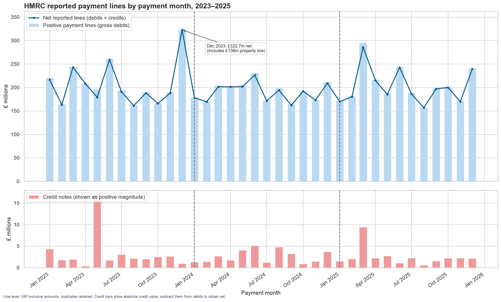
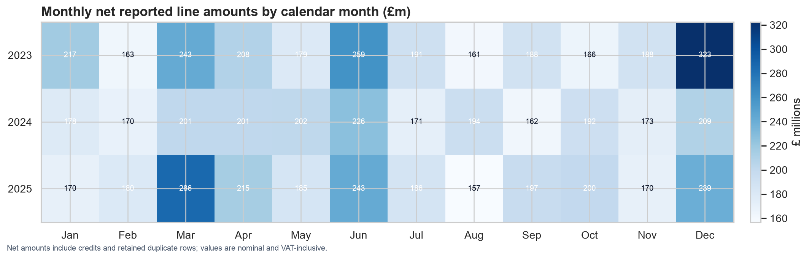
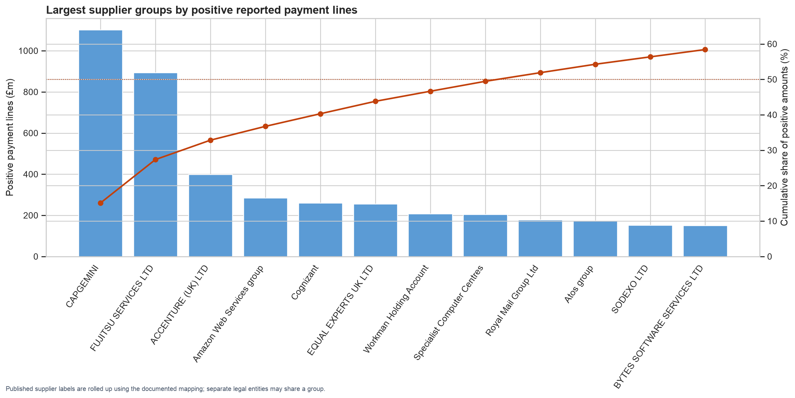
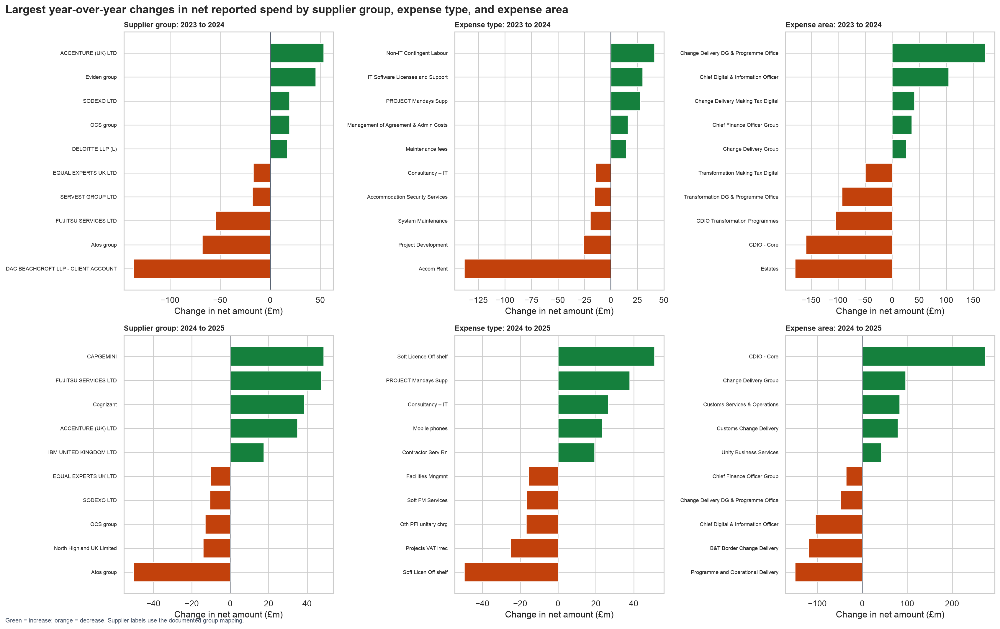
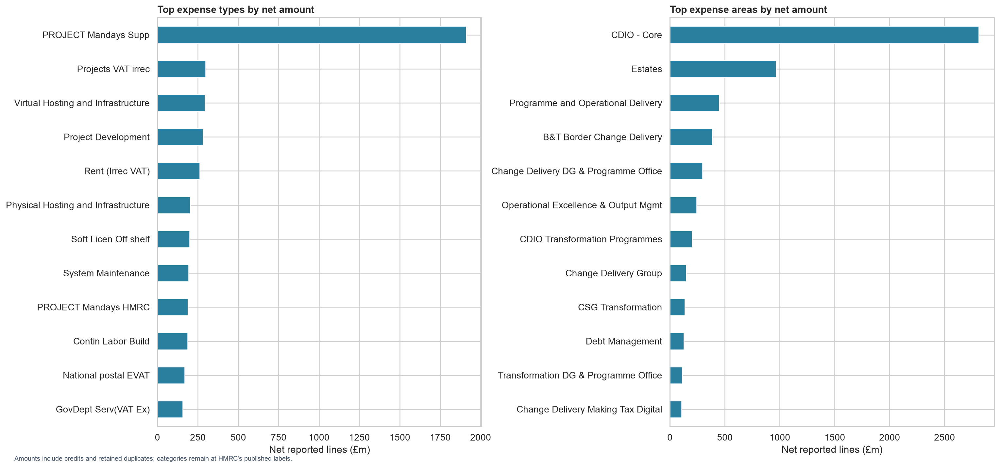
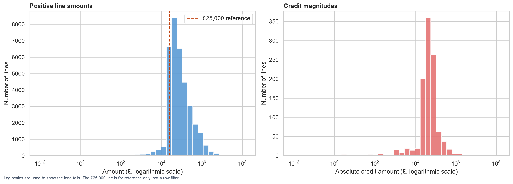
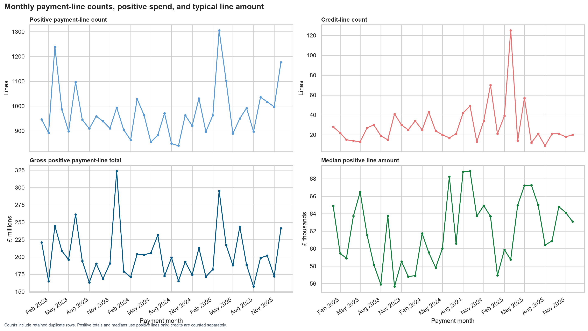
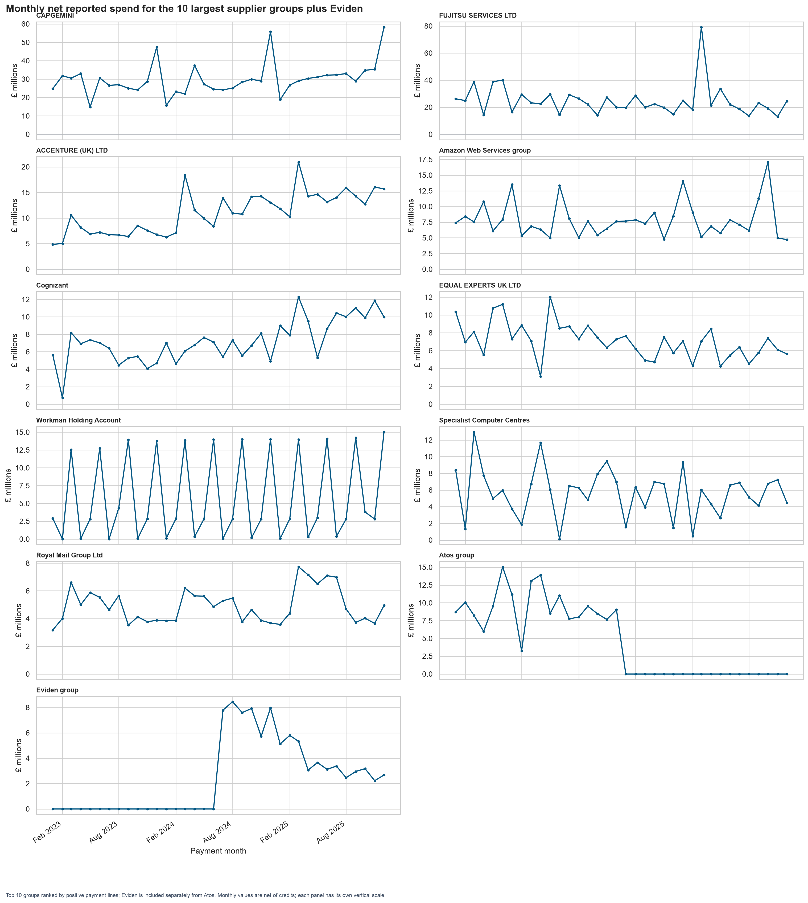
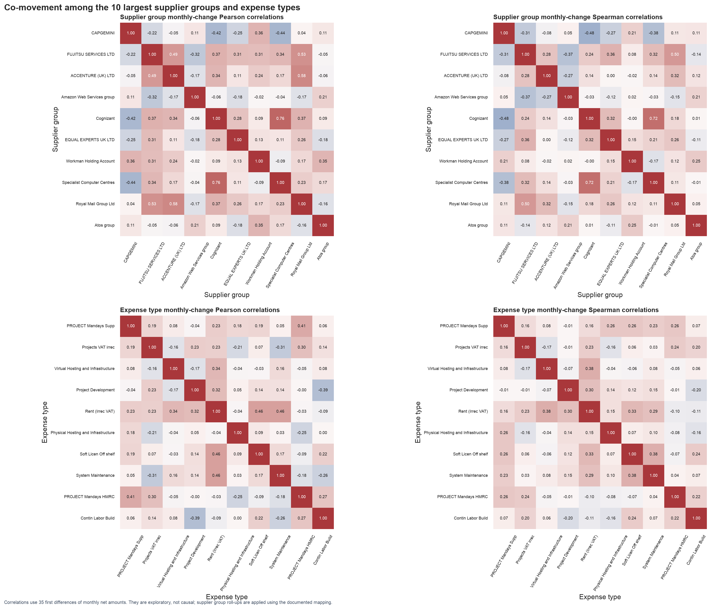
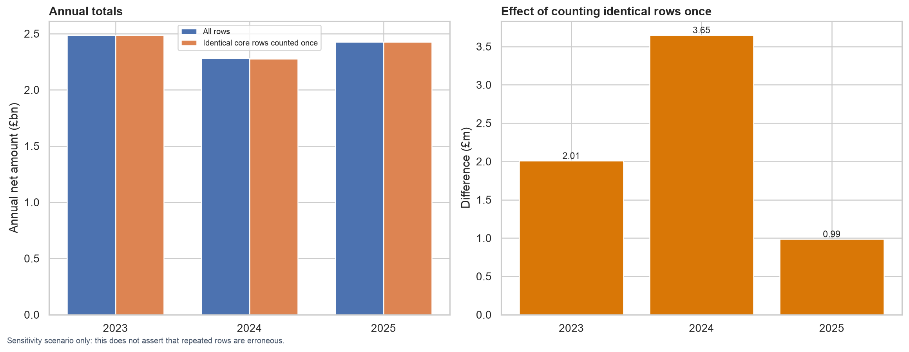

# HMRC spending disclosures: data understanding and exploratory analysis

**Reporting period:** January 2023–December 2025  
**Prepared:** 25 November 2026  
**Current status:** Data familiarisation, preparation, and Python EDA are complete; interactive visualisation is the next phase.  
**Purpose of this report:** Document the exploratory phase and propose the next visualisation work.

## Executive summary

This analysis reviews 36 monthly HMRC spending-disclosure files containing **36,061 populated payment lines**. Across the period, positive lines totalled **£7.296bn**, negative credit lines totalled **−£102.571m**, and net reported spend was **£7.193bn**.

Three findings stand out:

1. **Annual spend moved unevenly.** Net reported spend fell 8.3% in 2024, then increased 6.5% in 2025. The 2025 total was still 2.4% below 2023.
2. **Reported spend is concentrated.** The 12 largest analytical supplier groups account for 58.4% of positive payment-line amounts. The leading expense type was `PROJECT Mandays Supp`; the leading expense area was `CDIO - Core`.
3. **The data are useful for describing patterns, but not for attributing causes.** Large individual lines influence monthly totals; exact repeated rows have been retained; and the supplier-group mapping is an analytical overlay. These choices and limitations matter when interpreting the charts.

The work is exploratory, not an audit of HMRC accounts or a claim that any payment is erroneous.

This is an intermediate project deliverable, not the finished visualisation. The charts in this report are static Python EDA outputs. No Power BI or Excel dashboard has been built yet, and stakeholder review of an interactive version remains future work.

## Project process and status

I began by understanding the data before deciding what to chart. Questions and candidate visuals emerged during that familiarisation, then I refined the shortlist as the EDA showed which patterns were informative.

| Stage | What I did or plan to do | Status |
|---|---|---|
| 1. Data familiarisation | I reviewed the 36 monthly files, their period and structure, field meanings, payment-date and VAT conventions, credits, the £25,000 disclosure context, supplier/category labels, and repeated transaction references. | Complete |
| 2. Data audit and preparation | I checked file coverage, dates, amounts, blank/padding rows, and repeated records; I prepared a consistent working dataset while retaining all populated lines, credits, and duplicates. | Complete |
| 3. Python EDA | I explored monthly and annual spend, suppliers, expense types and areas, amount distributions, credits, line counts, repeat-row sensitivity, and month-to-month co-movement; I produced ten core static charts. | Complete |
| 4. Visualisation planning | I selected a practical stakeholder-focused shortlist from candidate questions raised during data familiarisation and refined through EDA. | Proposed in this report |
| 5. Interactive visualisation | I will build the agreed visuals in Power BI or Excel, validate totals and filters against the Python analysis, then review with stakeholders. | Not started |

## Scope and data

The dataset combines HMRC monthly CSV disclosures from January 2023 through December 2025. HMRC's public [spending over £25,000 collection](https://www.gov.uk/government/collections/hmrc-spending-over-25000) describes the published data. The analysis uses the supplied field guidance that amounts include VAT, negative amounts are credits, dates are payment dates, and a payment line below £25,000 may be part of a larger invoice.

| Measure | Result |
|---|---:|
| Monthly source files | 36 |
| Populated payment lines | 36,061 |
| Positive lines | 35,011 |
| Negative / credit lines | 1,049 |
| Zero-value lines | 1 |
| Positive-line total | £7,295,905,179.90 |
| Credits | −£102,571,038.86 |
| Net reported spend | £7,193,334,141.04 |

These are disclosed payment lines, not HMRC's complete expenditure, commitments, or invoice-level accounts. Totals are nominal and have not been adjusted for inflation.

## Data preparation and method

- Combined the 36 monthly files and retained all populated records. Empty padding rows were excluded; no populated payment line was removed during cleaning.
- Preserved positive amounts, credits, zero-value lines, supplier labels, transaction references, payment dates, expense types, and expense areas.
- Checked exact repeated records using the core payment fields. Found **103 groups** with **121 excess copies**. Because a repeated row is not by itself proof of an erroneous disclosure, all records remain in the main analysis.
- Built an explicit supplier-name crosswalk for charting: 87 source labels are represented by 37 mapped labels. Across the full dataset, distinct supplier labels decrease from 804 to 754 after mapping. Source labels and the cleaned data remain unchanged.
- Kept **Atos group** and **Eviden group** separate. The crosswalk is an analytical grouping, not a verified legal-entity register; some roll-ups may combine separate entities.
- Used Python with pandas for data preparation and analysis, and Matplotlib/seaborn for charts. The analysis script and supplier crosswalk are included in `analysis/`.

The charts use signed net amounts where the question is overall spend or annual change. Supplier concentration is calculated from positive payment lines, so it is not reduced by credits.

## Findings

### 1. Net spend declined in 2024 and partially recovered in 2025

| Year | Net reported spend | Change from prior year |
|---|---:|---:|
| 2023 | £2,486.55m | — |
| 2024 | £2,279.50m | −£207.05m (−8.33%) |
| 2025 | £2,427.28m | +£147.78m (+6.48%) |

The 2025 total was **£59.28m (2.38%) below 2023**. The highest monthly net total was **£322.65m in December 2023**; the lowest was **£156.81m in August 2025**. December 2023 includes a £138m property-related line, so the monthly peak should not be interpreted as a broad increase across all payments.

*Monthly signed totals show both the overall trajectory and the contribution of credits.*

*The heatmap makes year-to-year and within-year variation easier to compare; it does not establish a seasonal cause.*

### 2. A relatively small number of supplier groups account for a large share

By positive payment-line amount, the largest mapped groups were:

| Analytical supplier group | Positive-line amount | Share of positive total |
|---|---:|---:|
| Capgemini | £1,101.8m | 15.10% |
| Fujitsu | £894.4m | 12.26% |
| Accenture | £399.4m | 5.47% |

Together, the 12 largest groups account for **58.43%** of positive payment-line amounts. This concentration is calculated after applying the documented supplier crosswalk. It describes the grouping used in this analysis and should not be treated as confirmation of corporate ownership or legal-entity identity.

*Supplier concentration is calculated from positive lines; credits are shown separately in the overall totals.*

The annual-contributor chart highlights changes rather than total spend. From 2023 to 2024, the largest supplier-group reductions included DAC Beachcroft client account (−£136.7m), Atos (−£68.1m), and Fujitsu (−£54.7m); leading increases included Accenture (+£53.4m) and Eviden (+£45.4m). From 2024 to 2025, Capgemini (+£48.6m), Fujitsu (+£47.5m), and Cognizant (+£38.6m) had the largest increases among the supplier groups shown, while Atos declined by £50.4m.

*The chart compares the largest positive and negative contributors in three separate dimensions; contributors across panels should not be added together.*

### 3. Spend is concentrated in particular expense types and areas

The largest expense type by net amount was **`PROJECT Mandays Supp` (£1,910.7m)**, followed by **`Projects VAT irrec` (£297.7m)** and **`Virtual Hosting and Infrastructure` (£294.3m)**. The largest expense area was **`CDIO - Core` (£2,810.6m)**, followed by **Estates (£967.2m)** and **Programme and Operational Delivery (£447.9m)**.

These labels are the disclosure categories as analysed; this work has not independently validated their accounting definitions. Similar-looking or differently spelled labels were not merged unless covered by the supplier mapping.

*The chart ranks expense types and areas separately.*

### 4. Payment-line amounts are highly skewed, with credits and large values worth reviewing

The distribution is strongly right-skewed: most payment lines are much smaller than the largest lines. The maximum positive line was **£138m**; the largest credit was **−£14.67m**. These are review points, not evidence of errors.

There were **4,483 positive lines below £25,000** (12.8% of positive lines). This does not imply non-compliance: a line can be below the publication threshold while belonging to a larger invoice or payment.

*The distribution view highlights the long tail and makes unusually large values visible.*

### 5. Monthly payment-line counts and typical line size moved differently

Monthly positive-line counts ranged from **840** (September 2024) to **1,305** (March 2025). The monthly median positive line amount ranged from **£55,668** (October 2023) to **£68,861** (September 2024). Counts, medians, and totals answer different questions: a month can have higher total spend without having the most lines or the highest typical line amount.

### 6. Supplier time-series and correlations suggest questions for follow-up, not explanations

The supplier trend chart shows Atos-group net payments last appearing in June 2024, while Eviden-group net payments begin in July 2024. This timing could reflect a supplier, contract, or coding change, but the chart alone cannot establish a transfer or its cause. The pattern should be checked against procurement and contract records.

*Each supplier panel has its own vertical scale; compare the shape within a panel, not the height across different panels.*

The month-to-month correlation analysis uses **35 consecutive monthly changes**. Most relationships are small and should not be read as evidence that one supplier's spending caused another's to rise or fall. The strongest supplier-group pairing in the displayed set was Cognizant and Specialist Computer Centres (Pearson correlation ≈ **0.76**, Spearman ≈ **0.72**). This indicates that their monthly changes tended to move together in this period; it does not identify a business relationship or causal mechanism.

*The diagonal values are 1.0 because each series is perfectly correlated with itself. Off-diagonal values describe co-movement, not causation.*

### 7. Exact repeated rows have a small effect in a sensitivity scenario

All repeated rows remain in the primary totals. A separate sensitivity calculation counts each identical core-field record once; it is **not** a correction or a claim that any copy is invalid. The resulting annual net differences are approximately:

| Year | Difference under sensitivity scenario | Share of reported annual net |
|---|---:|---:|
| 2023 | £2.01m | 0.081% |
| 2024 | £3.65m | 0.160% |
| 2025 | £0.99m | 0.041% |

The chart shows that this scenario has a limited effect on annual totals. Any decision to remove a row would require source-level confirmation.

## Data-quality notes and limitations

- HMRC's disclosure is threshold-based and line-level. It does not represent all spending, and a line below £25,000 can be part of a larger invoice.
- Amounts are VAT-inclusive and dated by payment date, so they may not align with accounting-period or contract dates.
- Transaction numbers are not unique identifiers in this dataset: repeated numbers can occur across suppliers. They should not be used alone to deduplicate records.
- Duplicate sensitivity is illustrative. Repeated values may be legitimate; none were removed from the primary analysis.
- Supplier groups are an explicit but partly judgment-based analytical overlay. Verify them against an authoritative supplier register before making legal-entity claims.
- Expense labels were not comprehensively standardized. Similar labels may refer to separate categories, and apparent spelling variants need validation before consolidation.
- Three years of nominal, descriptive data are not sufficient to establish causation, explain procurement decisions, or prove seasonality. Correlations use only 35 month-to-month changes.
- Large values and unusual patterns are prompts for review against the original disclosure and supporting records, not findings of error or misconduct.

## Suggested follow-up

1. Validate the supplier crosswalk with an authoritative supplier or legal-entity register.
2. Investigate the Atos/Eviden timing and the largest payment/credit lines using contract, purchase-order, and accounting context.
3. Check recurring supplier patterns against known payment schedules.
4. Review expense-type and expense-area naming variants with the relevant coding owners before merging categories.
5. Extend the series as new monthly disclosures are released; consider inflation-adjusted comparisons for longer-term trend work.

## Proposed visualisation plan for the next phase

These are recommended dashboard visuals, not work already completed. They can be implemented in Power BI or Excel; the tool and final layout have not yet been chosen.

| Priority | Proposed visual | Why it is relevant and how to handle it |
|---|---|---|
| Core | **Overview:** KPI cards for positive payments, credits, net spend, positive-line count, and credit-line count; monthly positive/credit/net trend; annual net comparison. | Gives stakeholders scale and direction while keeping gross payments, credits, and net amounts distinct. Add a period filter and label amounts as nominal. |
| Core | **Supplier concentration and movement:** ranked/Pareto view of positive spend by supplier group, with a supplier selector and monthly trend. | Shows concentration and how leading groups change over time. Keep Atos and Eviden separate and identify all roll-ups as analytical groups. |
| Core | **Spend composition:** ranked bars for expense type and expense area, with filters or drill-down by year. | Shows where reported spend is classified. Keep the two dimensions separate; validate label variants before combining them. |
| Core | **Year-over-year change:** a waterfall/bridge of net change by supplier group, expense type, or area, one dimension at a time. | Makes the drivers of annual increases and decreases easier to explain. Do not add contributors from different dimensions together. |
| Supporting | **Payment-line review table:** high-value positive lines and credits with date, supplier, expense type/area, transaction reference, and amount. | Lets an analyst investigate the £138m line and large credits in context. Label these as review candidates, not errors or anomalies. |
| Supporting | **Monthly activity context:** positive and credit line counts alongside the median positive line amount. | Distinguishes changes in payment volume and typical line size from changes in total spend. |
| Optional | **Calendar heatmap of monthly net spend.** | Useful for comparing months across years if stakeholders ask about within-year patterns; do not present it as proof of seasonality. |

The amount-distribution chart can remain in the EDA appendix or support a focused payment-review page. Keep duplicate sensitivity as a data-quality note rather than a dashboard KPI: it is a scenario, not a correction. Keep the correlation heatmap in the exploratory appendix rather than the main stakeholder view; it uses only 35 month-to-month changes and does not establish cause. These choices prioritize the visuals with the clearest decision and communication value.

For either Power BI or Excel, the next build should include filters for period, supplier group, expense type, and expense area; consistent labels for gross/credit/net measures; and checks that filtered totals reconcile to the Python EDA. Final pages and measures should be confirmed during that build and stakeholder review.

## Reproducibility and included files

The reusable figure-generation script is [`analysis/run_eda.py`](../analysis/run_eda.py), and the supplier crosswalk is [`analysis/supplier_name_mapping.csv`](../analysis/supplier_name_mapping.csv). The script expects the cleaned file at `data/processed/hmrc_payments_clean.csv`. Neither that file nor the raw monthly files are included in this report package. Reproducing the figures therefore requires obtaining the disclosures from the [HMRC collection](https://www.gov.uk/government/collections/hmrc-spending-over-25000) and recreating the cleaned input in the expected format.

The report includes the ten core EDA charts. A separate expense-type-by-area drill-down was created but is intentionally deferred from this core report. The future Power BI or Excel visualisation remains outstanding.
